# 3DPrints catalog

78 models.

## (root)

| Name | Size W × D × H (mm) | Thumbnail |
|---|---|---|
| svb_bracket_small | 70.0 × 14.9 × 10.0 | 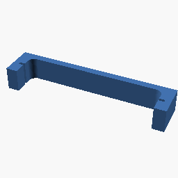 |
| svb_power_bracket | 71.0 × 14.9 × 20.0 | 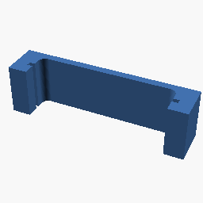 |

## ballastspreaders

| Name | Size W × D × H (mm) | Thumbnail |
|---|---|---|
| larger | 34.3 × 60.0 × 50.0 | 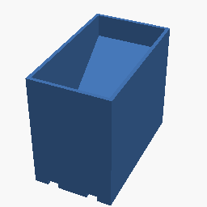 |
| master | 34.3 × 30.0 × 30.0 | 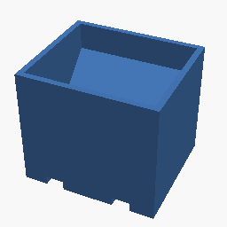 |

## Bracket for Uno-vertical

| Name | Size W × D × H (mm) | Thumbnail |
|---|---|---|
| Bracket for Uno - vertical mount (1) | 55.0 × 25.0 × 11.0 |  |

## brackets

| Name | Size W × D × H (mm) | Thumbnail |
|---|---|---|
| AutoReverser bracket | 84.0 × 53.0 × 12.0 |  |
| BoardBracket-Servo5 | 31.0 × 64.5 × 12.0 | 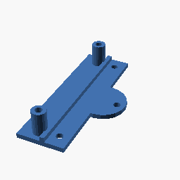 |
| BracketForServoRaised-1 | 37.0 × 33.0 × 15.7 | 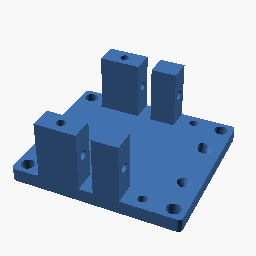 |
| BracketForServoRaised-2 | 43.0 × 53.0 × 12.0 | 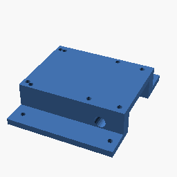 |
| BracketForServoRaised-3 | 4.0 × 76.0 × 4.0 | 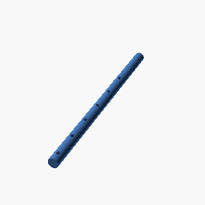 |
| BracketForServoRaisedB | 43.0 × 53.0 × 21.0 | 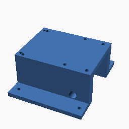 |
| BracketForServoRaisedc | 51.4 × 94.4 × 43.0 | 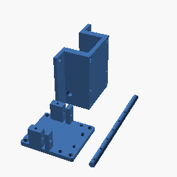 |
| LoudSpeakerBracketForEG1 | 16.0 × 28.0 × 4.1 | 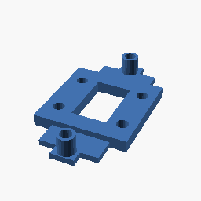 |
| MGP Bracket Loconet power | 44.0 × 74.0 × 12.0 |  |
| MGP Led Driver Bracket | 47.0 × 48.0 × 13.0 |  |
| MGP Occupancy Detector bracket | 60.0 × 97.0 × 12.0 |  |
| MGP Panel Decoder brackets | 59.0 × 31.0 × 12.0 |  |
| Motor driver dual board | 100.0 × 60.0 × 8.0 |  |
| SwitchMotorConnectorBoardBracket | 81.0 × 17.0 × 11.0 | 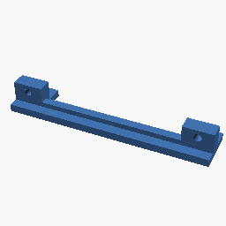 |

## Diverse

| Name | Size W × D × H (mm) | Thumbnail |
|---|---|---|
| Brakett_for_holde_led_lys_bar | 64.0 × 40.3 × 20.7 | 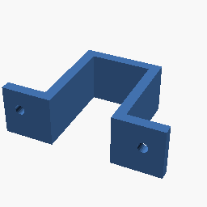 |
| KabelHolder | 60.0 × 80.0 × 60.0 | 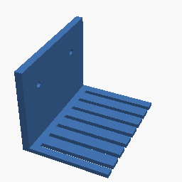 |
| KlemmeTool | 161.2 × 20.0 × 20.0 | 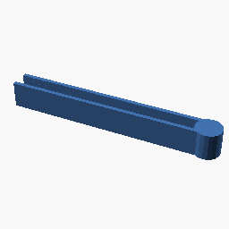 |
| Lenove power distance bracket | 11.0 × 10.0 × 2.3 |  |
| LoconetContactBracket | 67.0 × 26.2 × 36.0 | 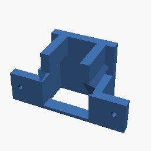 |
| MTHBridgeCoupling | 25.4 × 24.2 × 3.2 | 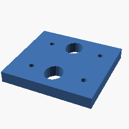 |
| OpphengsbrakettForSki | 94.0 × 71.0 × 30.0 | 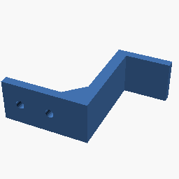 |
| SchlosserHolderVindu | 38.0 × 50.0 × 22.0 | 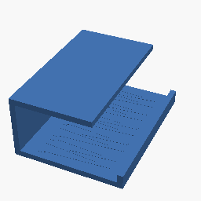 |
| SkibrakettSupport | 111.5 × 97.5 × 63.0 | 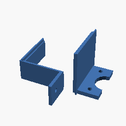 |
| SkiStavHolder | 36.0 × 80.0 × 40.0 | 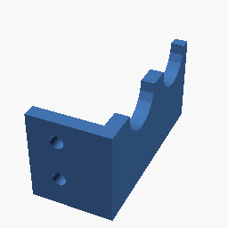 |
| Slider4Servo | 47.0 × 40.0 × 10.0 | 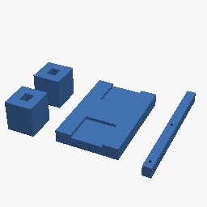 |
| Slider4Servo2 | 9.0 × 26.0 × 10.0 | 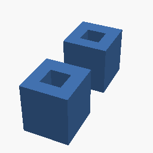 |
| Slider4Servo3 | 42.8 × 41.0 × 10.0 | 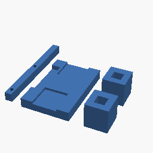 |
| Slider4ServoLong | 56.0 × 140.0 × 13.5 | 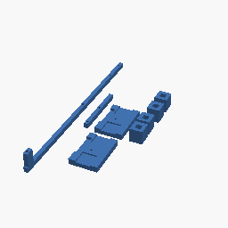 |
| StavSeparering | 80.0 × 30.0 × 3.0 | 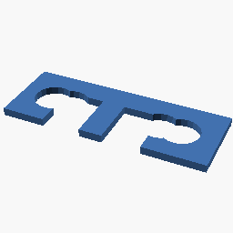 |
| Stillbord-FiddleYard | 180.0 × 150.0 × 2.0 | 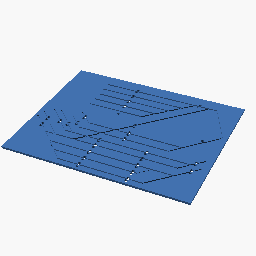 |
| TogglebryterHolder | 20.0 × 49.0 × 26.0 | 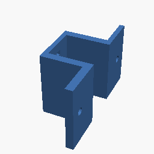 |
| TogglebryterHolderMP | 20.2 × 49.0 × 26.0 | 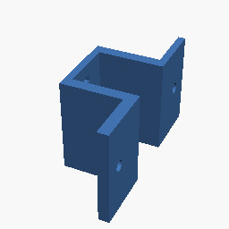 |
| UnderlagServoFeste | 40.0 × 30.0 × 3.4 | 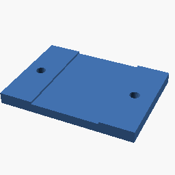 |
| VannslangeVinkel | 163.0 × 80.0 × 14.0 | 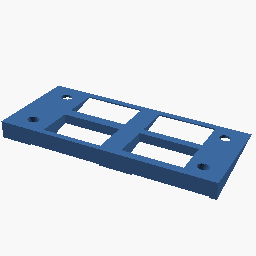 |

## DualSignalBox

| Name | Size W × D × H (mm) | Thumbnail |
|---|---|---|
| DualSignalBox | 148.5 × 136.0 × 10.0 | 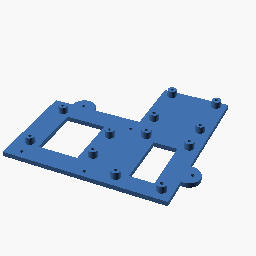 |
| I2C-ConnectorBoard | 30.0 × 56.5 × 7.4 | 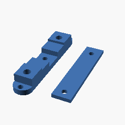 |
| Motorboards | 162.0 × 138.0 × 11.0 | 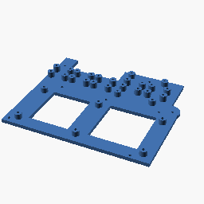 |
| Power Converter Board | 51.0 × 47.0 × 10.0 |  |
| Small Motorboards | 100.0 × 137.0 × 11.0 |  |
| Track detector Board | 76.0 × 57.0 × 10.0 |  |

## Hjulbraketter

| Name | Size W × D × H (mm) | Thumbnail |
|---|---|---|
| Aksel | 180.0 × 14.5 × 14.5 | 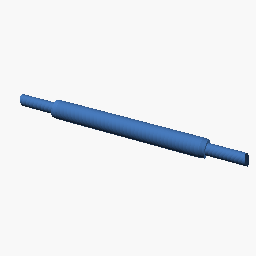 |
| HjulJusteringsBrakett 19mm Left | 40.0 × 100.0 × 16.0 |  |
| HjulJusteringsBrakett 19mm Right | 40.0 × 100.0 × 17.0 |  |
| HjulJusteringsBrakett 21mm Left | 40.0 × 100.0 × 16.0 |  |
| HjulJusteringsBrakett 21mm Right | 40.0 × 100.0 × 16.0 |  |

## Isabel

| Name | Size W × D × H (mm) | Thumbnail |
|---|---|---|
| Box | 85.0 × 140.0 × 40.0 | 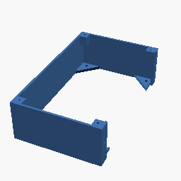 |
| Boxcover | 93.5 × 140.0 × 5.5 | 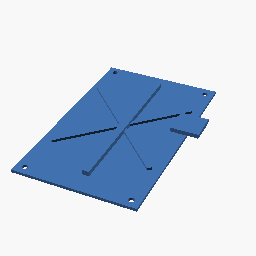 |
| IsabelFlowBrakett | 117.0 × 42.0 × 100.0 | 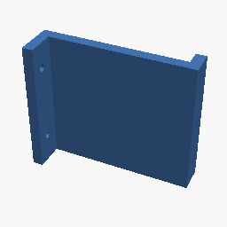 |

## Platting

| Name | Size W × D × H (mm) | Thumbnail |
|---|---|---|
| Grand Tumelo-Jaiks | 35.1 × 125.0 × 16.5 |  |

## Powersupplybracket

| Name | Size W × D × H (mm) | Thumbnail |
|---|---|---|
| PowerSupplyBracket | 80.0 × 38.0 × 7.0 | 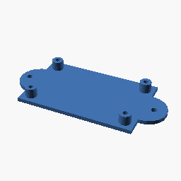 |

## RelayBoardBracket

| Name | Size W × D × H (mm) | Thumbnail |
|---|---|---|
| RelayBoardBracket | 30.0 × 56.5 × 12.0 | 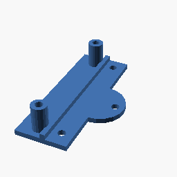 |

## Servo mount

| Name | Size W × D × H (mm) | Thumbnail |
|---|---|---|
| Bracket-with separate tube | 42.0 × 48.7 × 15.9 |  |
| servoMotorHolder | 48.0 × 20.0 × 19.0 |  |

## Servo mount/files

| Name | Size W × D × H (mm) | Thumbnail |
|---|---|---|
| Bracket-only | 42.0 × 33.0 × 15.9 |  |
| Bracket-reduced (1) | 37.0 × 33.0 × 15.7 |  |
| Bracket-reduced-with top | 37.0 × 35.9 × 29.5 |  |
| Bracket-reduced-with tube | 37.0 × 25.9 × 33.0 |  |
| Bracket-reduced | 37.0 × 33.0 × 15.7 |  |
| Bracket-with separate tube (1) | 42.0 × 52.4 × 15.8 |  |
| Bracket-with separate tube (2) | 42.0 × 52.4 × 15.8 |  |
| Bracket-with separate tube (3) | 42.0 × 48.7 × 15.9 |  |
| Bracket-with separate tube (4) | 42.0 × 48.7 × 15.9 |  |
| Bracket-with separate tube-May2018 | 42.0 × 48.7 × 15.9 |  |
| Bracket-with separate tube | 42.0 × 48.0 × 15.8 |  |
| PrecisionCheck | 15.0 × 20.0 × 20.0 |  |
| Separate tube-9mm | 14.0 × 14.0 × 9.0 |  |
| tube | 11.4 × 11.4 × 12.0 |  |
| tube2 | 11.4 × 11.4 × 12.0 |  |

## Ute

| Name | Size W × D × H (mm) | Thumbnail |
|---|---|---|
| 16mmKlemme-0 | 78.0 × 20.0 × 13.0 | 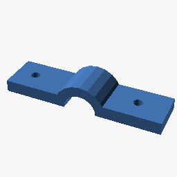 |
| 16mmKlemme | 78.0 × 20.0 × 21.0 | 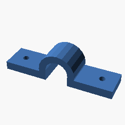 |
| Vannslagebrakett | 38.0 × 50.0 × 30.0 | 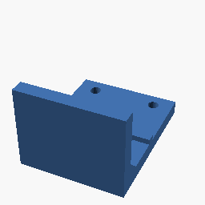 |
| Vannslangebrakett halfsize | 50.0 × 20.0 × 29.0 |  |

## Voltmeter

| Name | Size W × D × H (mm) | Thumbnail |
|---|---|---|
| Voltmeter-bracket | 60.0 × 18.0 × 15.0 | 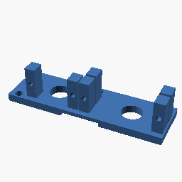 |
